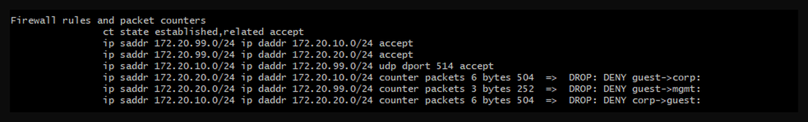
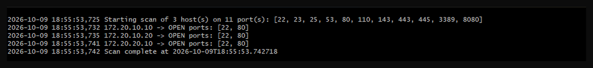
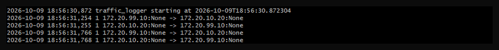

# Network Security Lab

[](https://github.com/adankhalid0/network-security-lab/actions/workflows/ci.yml)

A small Docker-based network project that simulates a segmented enterprise network. It shows, in practice, how to split a network into zones, control traffic between them with a firewall, and monitor what is happening. This is the kind of work a network engineer or IT support professional does day to day.

It is a voluntary side project that I built on my own.

## What the project does

Three zones are set up with Docker. They are modelled on VLAN-style segments (separate networks with a firewall between them), not real VLANs on a switch:

| Zone | Subnet | Purpose |
|------|--------|---------|
| `vlan10_corp` | 172.20.10.0/24 | Workstations and servers |
| `vlan20_guest` | 172.20.20.0/24 | Isolated guest network |
| `vlan99_mgmt` | 172.20.99.0/24 | Administration and monitoring |

A firewall container routes between the zones and controls traffic with **nftables**. The rules are simple:

- The management zone can reach the other two zones.
- Workstations can send syslog (UDP 514) to the monitoring server.
- The guest network is isolated and cannot reach any other zone.
- Everything that is blocked is counted. The counters are always available; the kernel log is not always visible from inside a container.

The hosts get a route to the other zones through the firewall (`172.20.X.1`), the same job a default gateway has on a real VLAN. See the rules in [`firewall/nftables.conf`](firewall/nftables.conf) and a simple network map in [`docs/network-diagram.md`](docs/network-diagram.md).

The management zone has a monitoring server with two small Python tools that I wrote:

- `port_scanner.py` checks which ports are open on a host or a whole subnet. I use it to confirm that the isolation works.
- `traffic_logger.py` listens to network traffic and logs source, destination and protocol, like a simple monitoring sensor.

The project also has an example WireGuard setup in [`wireguard/`](wireguard/) that shows how secure remote access into the management zone can be configured.

## How to run it

You need Docker and Docker Compose.

```bash
docker compose up --build -d
bash scripts/test.sh
```

`scripts/test.sh` runs all the isolation checks and prints PASS or FAIL for each. You can also test by hand:

```bash
docker compose exec monitor python port_scanner.py 172.20.10.10 172.20.10.20 172.20.20.10 --timeout 1
docker compose exec guest-host ping -c 2 -W 1 172.20.10.20      # should fail, guest is isolated
docker compose exec monitor ping -c 2 -W 1 172.20.10.20         # should succeed, management can reach corp
docker compose exec firewall nft list ruleset                   # shows the rules and how many packets each one dropped
docker compose exec monitor python traffic_logger.py --count 12
```

When you are done, stop and remove the containers and networks:

```bash
docker compose down
```

## Results

The isolation is tested on every push with GitHub Actions (`scripts/test.sh`). These are the results from my own runs.

**Firewall rules and counters.** Management is allowed into corp and guest. Traffic from guest to corp, guest to management and corp to guest is dropped, and each rule counts the packets it dropped.



**Port scan from the management zone.** The monitoring server finds ports 22 and 80 open on all three hosts, so management can see into both zones.



**Traffic log.** The traffic logger on the monitoring server captures traffic between management and the corp server.



## What I learned

- A container does not route between networks on its own. The firewall needs IP forwarding turned on, and each host needs a route to the other zones through it. Without the routes, the traffic never reached the firewall, even though the firewall rules were correct.
- Docker uses the first address in each subnet (`.1`) as its own gateway. To give that address to the firewall, I moved Docker's gateway to `.254`.
- Counters on the drop rules are a good way to prove that the firewall is doing its job. The kernel log is not always visible from inside a container, but the counters are.

## Tools used

Docker and Docker Compose, nftables, Python 3 (scapy, socket), WireGuard, GitHub Actions.
